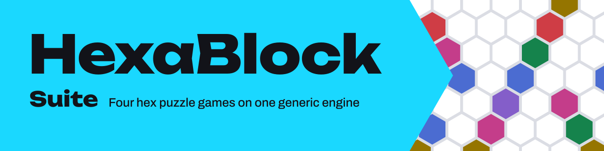
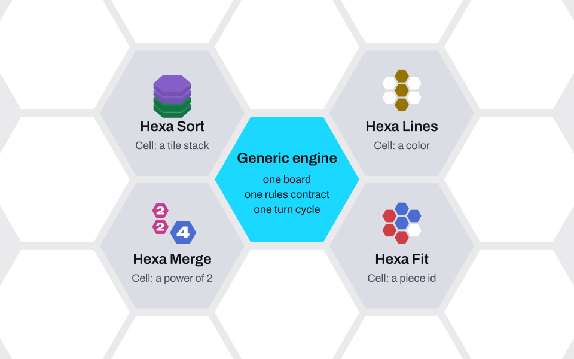
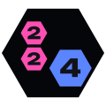

<picture>
  <source media="(prefers-color-scheme: dark)" srcset="assets/banner-dark.svg">
  
</picture>

  
  

HexaBlock Suite is a semester course project: one mobile app with four puzzle games on hexagonal boards, and one REST API behind it. The engine is the point of the project. All four games share one board, one rules contract and one turn cycle, and each game adds only its own rules.

## Status

The project is in the design phase. The requirements and the draft architecture diagrams exist. Game code does not exist yet.

The two repositories are skeletons with their quality gates. The app shows a home screen with the suite name. The API serves a health endpoint and holds the database wiring, which no module uses yet. The engine, the four games, the use cases, the API endpoints for accounts, progress, leaderboards and levels, and a published release do not exist yet.

## One engine, four games

<picture>
  <source media="(prefers-color-scheme: dark)" srcset="assets/engine-dark.svg">
  
</picture>

A conceptual view, not the class diagram. The draft class diagram and layer diagram, under team review, are in <a href="https://github.com/Hexablock-Suite/hexablock-app/blob/main/docs/architecture/classes.md">hexablock-app <code>docs/architecture/</code></a>.

<table>
  <tr>
    <td width="72" align="center"></td>
    <td><b>Hexa Lines</b> Place pieces from a tray. A full line on any of the three axes clears, and several lines at once make a combo.</td>
  </tr>
  <tr>
    <td width="72" align="center"></td>
    <td><b>Hexa Fit</b> Place, rotate and remove pieces until they cover the figure of the level. Undo and redo have no limit.</td>
  </tr>
  <tr>
    <td width="72" align="center"></td>
    <td><b>Hexa Sort</b> Place stacks of colored tiles. Same-color top tiles of neighbor stacks gather on the stack with the most of that color, and ten of one color clear the stack.</td>
  </tr>
  <tr>
    <td width="72" align="center"></td>
    <td><b>Hexa Merge</b> Slide every tile in one of six directions. Two equal tiles that collide merge into one tile of double value.</td>
  </tr>
</table>

The full comparison, with board, resolution, piece source, end of game, progress and undo per game, is in [`docs/REQUIREMENTS.md` §1](https://github.com/Hexablock-Suite/hexablock-app/blob/main/docs/REQUIREMENTS.md#1-product).

## Repositories

| Repository | What it is |
| --- | --- |
| [**hexablock-app**](https://github.com/Hexablock-Suite/hexablock-app)  | Mobile client: the four games on one generic engine.    |
| [**hexablock-api**](https://github.com/Hexablock-Suite/hexablock-api)  | REST backend: users, progress, leaderboards and level definitions, with Drizzle and OpenAPI docs.    |

Both repositories are public and use the MIT License.

## Where to read

- [hexablock-app `docs/REQUIREMENTS.md`](https://github.com/Hexablock-Suite/hexablock-app/blob/main/docs/REQUIREMENTS.md): the canonical requirements for both repositories, with assumptions, team decisions and open questions. The [hexablock-api copy](https://github.com/Hexablock-Suite/hexablock-api/blob/main/docs/REQUIREMENTS.md) holds the backend view and links back to it.
- Draft architecture, under team review: the client [layers](https://github.com/Hexablock-Suite/hexablock-app/blob/main/docs/architecture/layers.md) and [class diagram](https://github.com/Hexablock-Suite/hexablock-app/blob/main/docs/architecture/classes.md), and the backend [layers](https://github.com/Hexablock-Suite/hexablock-api/blob/main/docs/architecture/layers.md).
- [hexablock-app `docs/EXTENSIBILITY.md`](https://github.com/Hexablock-Suite/hexablock-app/blob/main/docs/EXTENSIBILITY.md): how a fifth game is added without a change to the engine. Today it is a placeholder.
- `AI_USAGE.md` in [hexablock-app](https://github.com/Hexablock-Suite/hexablock-app/blob/main/AI_USAGE.md) and [hexablock-api](https://github.com/Hexablock-Suite/hexablock-api/blob/main/AI_USAGE.md): the log of AI use per task.
- `AGENTS.md` in [hexablock-app](https://github.com/Hexablock-Suite/hexablock-app/blob/main/AGENTS.md) and [hexablock-api](https://github.com/Hexablock-Suite/hexablock-api/blob/main/AGENTS.md): the contributor rules. Each rule names its gate or says "no gate".

## How the team works

| Practice | Where it is checked |
| --- | --- |
| Conventional Commits, in English. | The `commit-msg` hook runs commitlint. Gates: `test/gates/commit-message-gate.test.ts` (app) and `test/gates/commit-message.gate.spec.ts` (api). The api CI also runs commitlint on each pull request. |
| `pnpm verify` runs lint, format check, typecheck, tests and the layer rules. The app adds the Pact check, the api adds the OpenAPI drift check. | The `verify` job in `.github/workflows/ci.yml` runs it on every pull request and every push to `main`. The `pre-push` hook runs its fast part: lint, typecheck and the layer rules. |
| Layer rules. Domain code imports only domain code and no framework. In the app, the engine never imports a game, and a game never imports another game. | `pnpm arch` with `.dependency-cruiser.cjs`. Gates: `test/gates/architecture-gate.test.ts` (app) and `test/gates/architecture.gate.spec.ts` (api). |
| Deterministic core. Domain code receives time and randomness by injection, so a seed reproduces a game. | Gates: `test/gates/domain-purity-gate.test.ts` (app) and `test/gates/determinism.gate.spec.ts` (api). |
| Contract tests. The app writes a [Pact](https://docs.pact.io/) contract. | The CI `contract` job in each repository verifies it against the API. |
| Every test is named `should_<expected_result>_when_<condition>`. | The linter rejects other names. |
| Every change reaches `main` through a pull request with a green `verify` job. | api rule `R-protected-main`, no gate. |
| Each task logs its AI use in `AI_USAGE.md`. | Rule `R-ai-usage-log`, no gate. |
